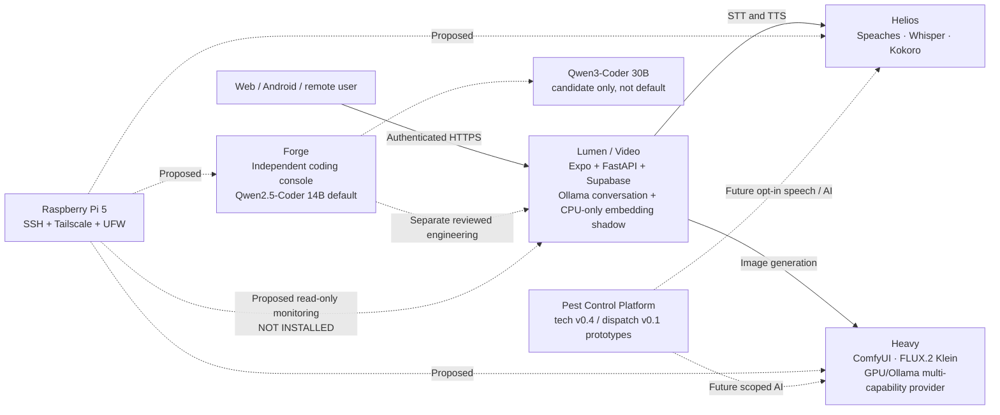

# Lumen AI/LLM infrastructure map — October 13, 2026
> **Documentation checkpoint only.** No runtime change, no security fix deployed and no new monitoring service installed. This public-repository version intentionally omits private network addresses, SSH fingerprints, backup paths/hashes and access details. For the private five-node inventory, use the owner-only October 13 handoff bundle.

## Current topology

Solid arrows represent existing documented provider flows; dashed represent independent development, a candidate, or future integration. It is **not** a distributed inference scheduler or a claim that every model is active now.

## Five physical nodes and roles

| Node | Role | Point-in-time verification |
|---|---|---|
| `aiLumen-llm-video` | Companion frontend, API, Supabase/Auth/Storage, conversation inference, CPU-only embedding shadow | Service health returned `status/ollama/database=ok` after the Oct 13 encrypted backup transfer |
| `aiLumen-llm-tts-stt` (Helios) | Speech STT/TTS (Speaches/Whisper/Kokoro) | Speaches returned HTTP 200 and host firewall was enabled |
| `aiLumen-llm-heavy` | GPU multi-capability inference and FLUX.2 Klein image provider | Earlier image-generation acceptance, Oct 13 SSH confirmed; current loaded models/VRAM not remeasured |
| `ailumen-forge` | Independent coding-agent development and tests, reviewed approvals | Key-only SSH routes verified; draft grounding/coding previews remain separate from stable |
| `pi-aiLumen` | **Recommended** noncritical health observer | Raspberry Pi 5, SSH/Tailscale/firewall verified; monitor script, timer, dashboard and alerts **not installed** |

## Confirmed vs pending

- Lumen remains healthy and the existing data was exported as a PostgreSQL logical dump, Storage/Edge volume archives and a configuration copy. GPG-encrypted ciphertext was transferred to a second physical host and equal checksums verified. **Isolated restore, complete current secrets/media inventory and geographically separate backup are not complete.**
- Lumen's host firewall remains **inactive** at this checkpoint and LAN probes reached several Docker-published developer/database/admin services. There is **no completed** port rebinding, firewall hardening or Docker isolation on the companion node. Do not infer public-internet exposure from local probes alone.
- Helios host UFW is active but its Docker-published speech API requires a separate access restriction review.
- Oct 12 semantic memory is a companion/owner-scoped shadow index (pilot 97 current embeddings for 97 active memories); **semantic retrieval is disabled for live replies**. Existing lexical recall remains. The source of truth is the memory project checkpoint.
- Forge's distinct coding-model default and development previews do not change Lumen inference routing.
- The separate Pest Control Platform has design prototypes and requirements, not production deployment, a verified runtime host or a real backend.

## Freeze and handoff

At the time of the review, the owner was offsite on Helios and SSHed into the Video host. **Do not remotely alter Video SSH/UFW, Supabase lifecycle, published ports, or Tailscale Serve without physical-console recovery, explicit review and rollback tests.**

Preserve the existing uncommitted `supabase/config.toml` and local `.before-*` files. No local git checkout, configuration or test results are implied by this documentation-only remote commit. Keep app feature work on its own milestone and reverify live host branch/commit prior to any deployment.
